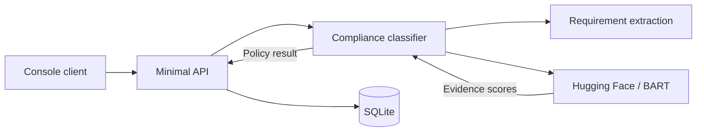

# Compliance Monitor

Compliance Monitor helps reviewers check whether a reported action provides evidence of following a written guideline. It returns COMPLIES, DEVIATES, or UNCLEAR, stores each analysis, and exposes history and summary counts.

Built with a .NET 10 Minimal API, EF Core SQLite, and hosted `facebook/bart-large-mnli` inference.

SQLite provides local persistence. The API is intended for local use: endpoints do not require authentication, and history returns all stored analyses.

## Architecture



Analysis extracts requirements, obtains model evidence scores, and applies the application's compliance policy before saving a successful result. Absent or unevaluable guidelines are handled locally. History and summary read SQLite without invoking the model.

## Prerequisites

### Console client

To run the console client from this source code, you need:

1. **[.NET 10 SDK](https://dotnet.microsoft.com/en-us/download/dotnet/10.0)** installed on your computer. Choose the SDK download for your operating system and processor. It supplies the `dotnet` command used below to build and launch the app.
2. **A terminal**: Terminal on macOS, a shell on Linux, or PowerShell on Windows. The menu appears in this terminal.
3. **A running Compliance Monitor API**. Start it using the setup instructions below and leave it running while you use the client. The client connects to `http://localhost:5000` by default.

Check the SDK installation:

```sh
dotnet --list-sdks
```

The output should include a `10.0.x` SDK. If `dotnet` is not found after installation, reopen your terminal.

### API setup

The API uses the same .NET 10 SDK. Initial database setup also requires [EF Core CLI (`dotnet-ef`) 10.x](https://learn.microsoft.com/en-us/ef/core/cli/dotnet); its installation command is included below.

For live analysis, configure a Hugging Face account with an inference token, Inference Providers permission, and available credits. The token is configured on the API; the console client sends requests to the API.

## Setup and run

Commands below use a macOS/Linux shell. In PowerShell, replace `export ASPNETCORE_ENVIRONMENT=Development` with `$env:ASPNETCORE_ENVIRONMENT = "Development"`. From the repository root:

```sh
export ASPNETCORE_ENVIRONMENT=Development
dotnet restore
dotnet user-secrets set "HuggingFace:Token" "YOUR_TOKEN" --project ComplianceMonitor.Api
# If the EF CLI is not already installed:
dotnet tool install --global dotnet-ef --version '10.*'
cd ComplianceMonitor.Api
dotnet ef database update
dotnet run --no-launch-profile --urls http://localhost:5000
```

The setup commands enable Development so the API loads User Secrets. Never commit or print the token. For other environments, supply `HuggingFace__Token` through secure environment configuration. The default SQLite path is relative to the working directory; run migrations and the API from the API directory. `ConnectionStrings__Compliance` can override the connection string.

## Run the client

After installing the .NET 10 SDK and starting the API, open a second terminal in the repository folder containing `ComplianceMonitor.slnx`:

```sh
dotnet run --project ComplianceMonitor.Client
```

The interactive menu lets you analyze your own action and guideline, view history, view summary, or exit. Analysis asks for confirmation before submitting because it may consume inference credits and creates a record on success. Browsing history and summary does not invoke the model.

To run the four supplied examples followed by history and summary:

```sh
dotnet run --project ComplianceMonitor.Client -- --demo
```

Demo mode asks for confirmation: it normally makes three paid inference requests and creates four records if all analyses succeed. It stops on the first failure without retrying. For a different API address, append the URL in either mode, for example:

```sh
dotnet run --project ComplianceMonitor.Client -- http://localhost:5184
```

The default address is `http://localhost:5000`. Use `--help` for usage. Ctrl+C cancels the client; a submitted analysis may still have used credits or been saved, so check history before resubmitting after an interrupted or timed-out request.

## Run tests

From the repository root:

```sh
dotnet build
dotnet test
```

By default, automated tests use fake classifiers/HTTP handlers and isolated in-memory SQLite, without live inference calls or credit charges. The live acceptance test is skipped unless explicitly enabled with `RUN_LIVE_ACCEPTANCE=1`.

To run the live acceptance test using inference credits:

```sh
RUN_LIVE_ACCEPTANCE=1 dotnet test --filter SuppliedCasesPassLiveAcceptance
```

## API

- `POST /analyze`: JSON `action` and `guideline`; returns those fields, `result`, `confidence`, and UTC `timestamp`. Empty inputs return 400; upstream failures return 502 and timeouts return 504.
- `GET /history`: analyses ordered by descending timestamp.
- `GET /summary`: total and counts for COMPLIES, DEVIATES, UNCLEAR, including zero counts.

### Example request and response

With the API running, submit an analysis from another terminal. This request creates a stored record and uses inference credits.

```sh
curl --request POST http://localhost:5000/analyze \
  --header 'Content-Type: application/json' \
  --data '{"action":"Closed ticket #48219 and sent confirmation email","guideline":"All closed tickets must include a confirmation email"}'
```

Illustrative successful response; the model result, confidence, and timestamp may vary:

```json
{
  "action": "Closed ticket #48219 and sent confirmation email",
  "guideline": "All closed tickets must include a confirmation email",
  "result": "COMPLIES",
  "confidence": 0.675,
  "timestamp": "2026-10-14T03:00:00Z"
}
```

Retrieve saved analyses and result counts:

```sh
curl http://localhost:5000/history
curl http://localhost:5000/summary
```

## Policy and limitations

COMPLIES requires evidence for every extracted mandatory requirement. DEVIATES means at least one requirement is unsupported or contradicted under the application's strict verification policy: missing evidence is not proof of a real-world violation. UNCLEAR means an explicitly absent or unevaluable guideline.

The bounded extractor supports must/shall clauses, sentences separated by punctuation, repeated mandatory predicates, and a small set of coordinated passive predicates. It preserves object lists. Conditions, exceptions, alternatives and nonmandatory wording are unevaluable. This is not a general English parser: ambiguous conjunctions and unrecognized structures can still be misinterpreted.

Each requirement becomes a hypothesis scored independently against the action alone, with `multi_label=true` and `hypothesis_template="{}"`. All scores must meet the provisional 0.55 threshold. A recurrence guard also requires matching cadence evidence (hourly/daily/weekly/monthly/yearly or every N time units). It is deliberately conservative and can reject equivalent paraphrases or dated records; it does not verify schedules from external records. Sequencing, quantities, negation and nuanced rules remain model limitations.

Confidence is the weakest requirement's model evidence score, including when a recurrence guard overrides the model. It is not a calibrated probability that the returned result is correct. No-guideline confidence 1 is a deterministic rule value; unevaluable guidelines use 0. The zero-shot API does not expose the full NLI neutral/contradiction distribution. See [Hugging Face's API documentation](https://huggingface.co/docs/inference-providers/tasks/zero-shot-classification).

Automated tests use simulated Hugging Face responses to verify request formatting, classification rules, and error handling without consuming inference credits. Model accuracy is separate from these tests. The 0.55 threshold is a decision boundary, not a calibrated probability of compliance.
